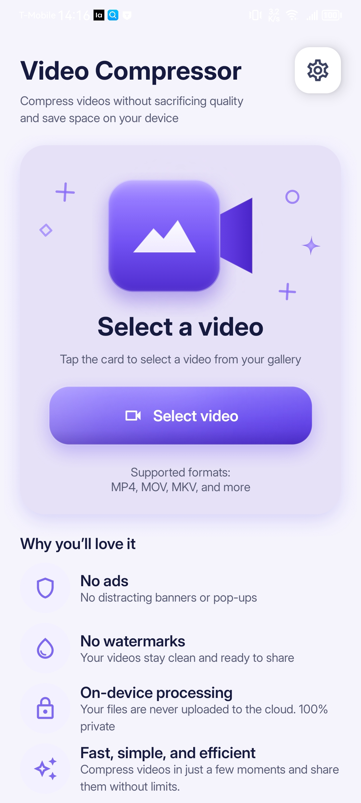
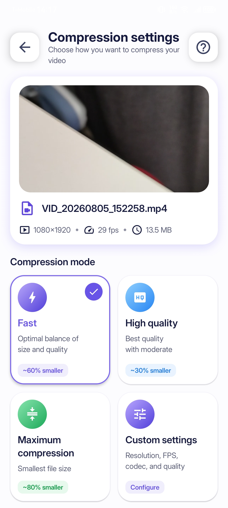
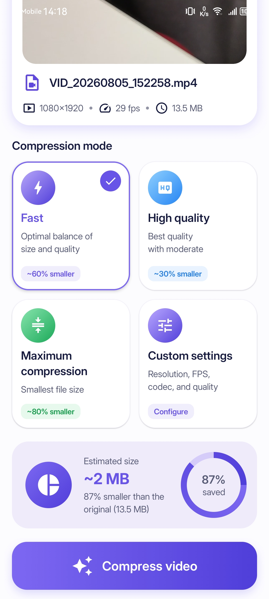
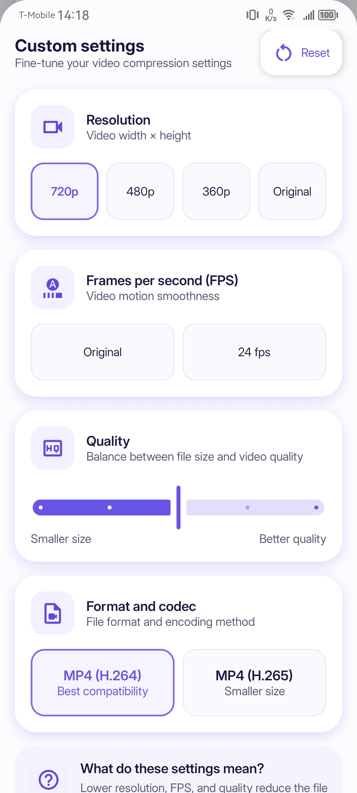
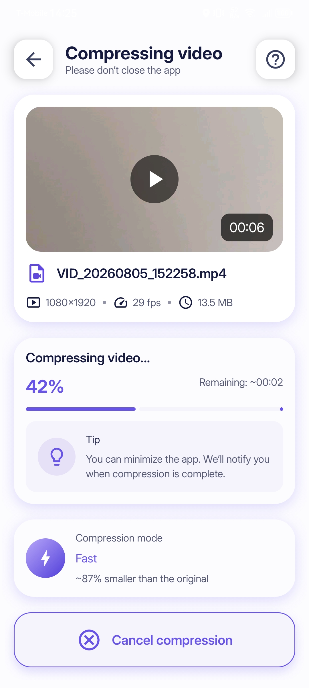
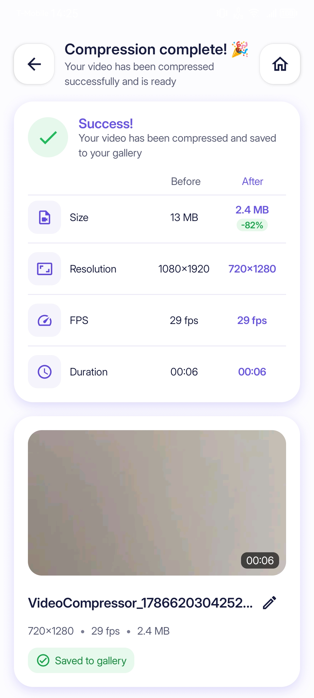
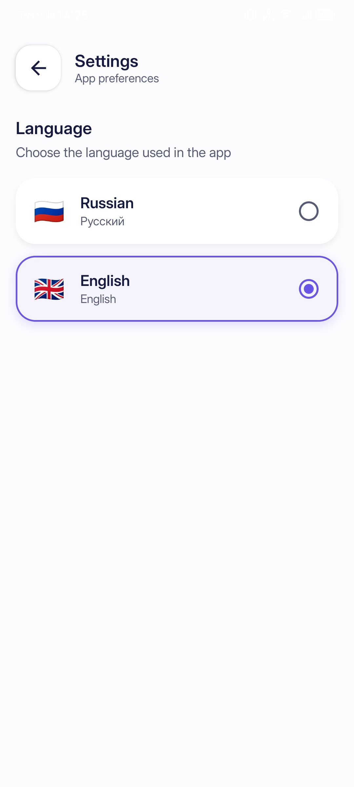
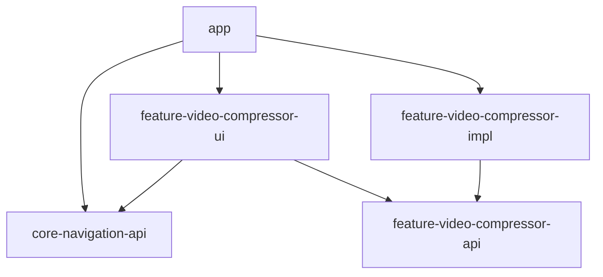
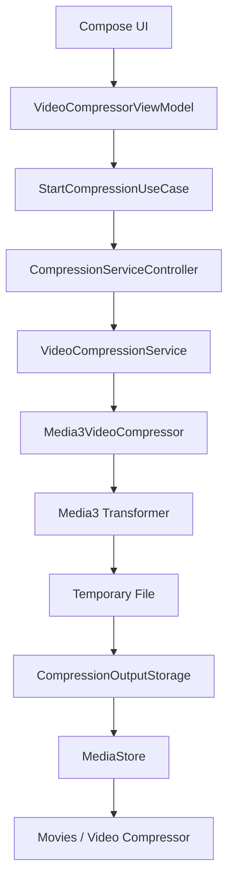

# Offline Video Compressor

<p align="center">
  <b>A modern Android application for on-device video compression.</b>
</p>

<p align="center">
  Reduce video file size, adjust compression settings, and save the result directly to the device gallery — without uploading files to external servers.
</p>

<p align="center">
  
  
  
  
  
  
</p>

> All video processing is performed locally on the device.

---

## Screenshots

<p align="center">
  
  
  
</p>

<p align="center">
  
  
  
</p>

<p align="center">
  
</p>

---

## Features

- Video compression directly on the device
- No cloud uploads
- Compression presets
  - Fast
  - High quality
  - Maximum compression
- Custom compression settings
  - Resolution
  - Frame rate
  - Video quality
  - H.264 / H.265 codec
- Compression size estimation before processing
- Real-time compression progress
- Estimated remaining compression time
- Background compression using a Foreground Service
- Compression progress notification
- Compression cancellation
- Automatic saving to the system gallery
- Before / after compression statistics
- Sharing compressed videos
- Re-compressing an already compressed video
- English and Russian localization
- Per-app language selection

---

## Architecture

The project follows a modular architecture with separated API, implementation, UI, and navigation layers.



The modules are separated by responsibility:

```text
app
│
├── core-navigation-api
│
├── feature-video-compressor-api
│
├── feature-video-compressor-impl
│
└── feature-video-compressor-ui
```

---

## Compression Flow

The compression pipeline is built around a Foreground Service and Media3 Transformer.



Compression state is propagated back to the UI through `Flow`:


---

## Tech Stack

| Area | Technology |
|---|---|
| Language | Kotlin |
| UI | Jetpack Compose, Material 3 |
| Architecture | MVVM, Clean Architecture |
| Dependency Injection | Hilt |
| Async | Kotlin Coroutines, Flow |
| Navigation | Navigation Compose |
| Video processing | Android Media3 Transformer |
| Video preview | Media3 ExoPlayer |
| Background work | Foreground Service |
| File publishing | MediaStore |
| Localization | Android resource locales / AppCompat locales |

---

## Video Compression

Video processing is implemented using Android Media3 Transformer.

The compressor can modify:

- output resolution
- frame rate
- video bitrate
- codec
- audio preservation

Output dimensions preserve the original aspect ratio and unnecessary upscaling is avoided.

The resulting file is first written to a temporary location and then published to `MediaStore`.

Compressed videos are stored in:

```text
Movies/Video Compressor
```

---

## Background Processing

Compression is executed inside a Foreground Service.

This allows the operation to continue when the application is moved to the background.

The notification displays compression progress and provides an action for cancelling the current operation.

For Android 15 and newer, the service uses the `mediaProcessing` foreground service type.

---

## Compression Progress

Media3 Transformer provides actual export progress from `0` to `100`.

The application uses this value to update the UI and estimates the remaining processing time based on elapsed time and current progress.

---

## Compression Size Estimation

Before compression starts, the application provides an approximate resulting file size.

The estimation takes into account:

- source video dimensions
- target resolution
- frame rate
- compression quality
- source size
- source duration
- approximate output bitrate

The displayed value is an estimate. Final output size depends on the actual video content and encoder behavior.

---

## Localization

Currently supported languages:

- English
- Russian

Default resources:

```text
res/values/
```

Russian resources:

```text
res/values-ru/
```

The application also supports changing its language independently from the system language.

---

## Project Structure

```text
OfflineVideoCompressor
│
├── app
│   ├── navigation
│   └── presentation
│       └── screens
│           └── settings
│
├── core-navigation-api
│
├── feature-video-compressor-api
│   ├── model
│   └── usecase
│
├── feature-video-compressor-impl
│   ├── compressor
│   ├── notification
│   ├── service
│   └── storage
│
└── feature-video-compressor-ui
    ├── navigation
    └── presentation
        ├── home
        ├── settings
        ├── custom
        ├── progress
        └── result
```

---

## Privacy

Video files are processed entirely on the user's device.

The application does not upload videos to a remote server for compression.

---

## Requirements

- Android 10+
- Minimum SDK: 29

---

## Status

The project is currently under active development.

Planned improvements include:

- further compression tuning
- UI polishing
- more output configuration options
- improved error handling
- additional device testing

---

## Author

**Grigory Liashchenko**

Android Developer

## License

Copyright © 2026 Grigory Liashchenko. All rights reserved.

This project is distributed under the [Offline Video Compressor Source Available License](LICENSE).

You are free to view, study, modify, and reuse portions of the source code in independent personal or commercial projects, subject to the license terms.

**Redistribution, repackaging, or publication of Offline Video Compressor, including substantially equivalent modified or rebranded versions, is prohibited without prior written permission from the copyright holder.**

The project's name, logo, and original branding assets may not be reused without permission.

See the [LICENSE](LICENSE) file for the full terms.
